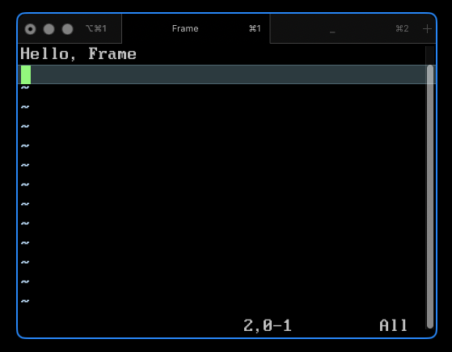

<h1 align="center">Frame</h1>

<p align="center">A macOS menu-bar app that outlines the focused window in blue.</p>

<p align="center">
  <a href="LICENSE"></a>
</p>

<p align="center">
  
</p>

## Setup

Requires macOS 13+, [uv](https://docs.astral.sh/uv/), and Python 3.12 ([python.org](https://www.python.org/downloads/macos/) or `brew install python@3.12`).

Double-click `build_app.command`, then grant **Accessibility** permission when prompted.
The app installs to `~/Applications/Frame.app`. The build uses an isolated Python 3.12 environment and leaves the development `.venv` untouched.

## Development

Requires Python 3.10+ and uv.

### Run from source

```sh
uv sync
uv run python -m frame
```

### Test

```sh
uv run python -m unittest discover -s tests
```

## License
[MIT](LICENSE). Built with [Python](https://www.python.org/), [PyObjC](https://pyobjc.readthedocs.io/) for native macOS APIs, and [py2app](https://py2app.readthedocs.io/) for app bundling.
